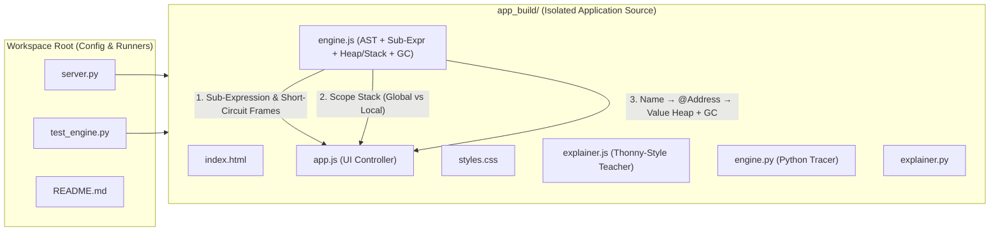

# Implementation Plan: Thonny-Style Visual Execution Model & `app_build/` Refactoring

## Root Cause Note on Your Screenshot (`⚠ len is not defined`)
In your screenshot of `binary_search(arr, target)`, Line 2 (`left, right = 0, len(arr) - 1`) triggered `len is not defined` because `evalExpr` in [engine.js](file:///C:/Users/CVT/.gemini/antigravity/scratch/code-flow-visualizer/engine.js#L1511-L1522) previously matched `len(...)` only when it was the **entire** expression (`^(len|min|max|abs|sum)\((.+)\)$`). Because `len(arr) - 1` is a compound expression (`len(arr)` inside subtraction), it fell through to JavaScript evaluation where `len` was not in scope.

**Phase 2 (Step-by-Step Expression Evaluator)** directly resolves this by evaluating nested sub-expressions inner-first (`arr` $\rightarrow$ `[1, 3, 5, 7, 9, 11, 13]` $\rightarrow$ `len(...)` $\rightarrow$ `7` $\rightarrow$ `7 - 1` $\rightarrow$ `6`) and binding Python built-ins (`len`, `min`, `max`, `abs`, `sum`, `range`, `int`, `float`, `str`, `bool`, `list`, `round`) inside all sub-expression evaluations.

---

## Architectural Overview

---

## Comprehensive Task List & Planned File Revisions

### Phase 1: Workspace Source Code Isolation (`app_build/`)
- [x] **Task 1.1 — Create `app_build/` and Migrate Core Application Files**
  - Create and upgrade application source files in `C:\Users\CVT\.gemini\antigravity\scratch\code-flow-visualizer\app_build\`:
    - [app_build/__init__.py](file:///C:/Users/CVT/.gemini/antigravity/scratch/code-flow-visualizer/app_build/__init__.py)
    - [app_build/index.html](file:///C:/Users/CVT/.gemini/antigravity/scratch/code-flow-visualizer/app_build/index.html)
    - [app_build/styles.css](file:///C:/Users/CVT/.gemini/antigravity/scratch/code-flow-visualizer/app_build/styles.css)
    - [app_build/engine.js](file:///C:/Users/CVT/.gemini/antigravity/scratch/code-flow-visualizer/app_build/engine.js)
    - [app_build/explainer.js](file:///C:/Users/CVT/.gemini/antigravity/scratch/code-flow-visualizer/app_build/explainer.js)
    - [app_build/app.js](file:///C:/Users/CVT/.gemini/antigravity/scratch/code-flow-visualizer/app_build/app.js)
    - [app_build/engine.py](file:///C:/Users/CVT/.gemini/antigravity/scratch/code-flow-visualizer/app_build/engine.py)
    - [app_build/explainer.py](file:///C:/Users/CVT/.gemini/antigravity/scratch/code-flow-visualizer/app_build/explainer.py)
- [x] **Task 1.2 — Update Root Configuration & Runner Scripts**
  - Update [server.py](file:///C:/Users/CVT/.gemini/antigravity/scratch/code-flow-visualizer/server.py) in the root folder to serve static UI files from `app_build/` and import `trace_python_program` / `generate_step_explanation` from `app_build`.
  - Update [test_engine.py](file:///C:/Users/CVT/.gemini/antigravity/scratch/code-flow-visualizer/test_engine.py) and [README.md](file:///C:/Users/CVT/.gemini/antigravity/scratch/code-flow-visualizer/README.md) in the root folder to reference `app_build/`.

---

### Phase 2: Step-by-Step Expression Evaluator (Thonny IDE Mechanics)
- [x] **Task 2.1 — Recursive Sub-Expression Stepper in `app_build/engine.js` & `app_build/engine.py`**
  - Implement `evaluateExpressionWithSteps(expr, scopeVars, ...)` that decomposes compound expressions into ordered **Thonny-style inline substitution frames (`exprFrames`)**:
    1. **Variable & Index Resolution**: Replace variable identifiers and list lookups (`arr[mid]`) with their concrete runtime values.
    2. **Inner Function / Built-in Calls**: Evaluate `len(arr)`, `min(...)`, `max(...)`, `abs(...)`, `sum(...)`, `range(...)`, or user function calls and replace the call substring with its result.
    3. **Parenthesized & Arithmetic Sub-Expressions**: Evaluate innermost parentheses and binary operations following Python precedence (`(left + right) // 2` $\rightarrow$ `(0 + 6) // 2` $\rightarrow$ `6 // 2` $\rightarrow$ `3`).
    4. **Comparison & Boolean Operators**: Evaluate relational operators (`7 == 7` $\rightarrow$ `True`, `c >= ans` $\rightarrow$ `-2 >= -2` $\rightarrow$ `True`).
  - Provide all safe Python built-in functions (`len`, `min`, `max`, `abs`, `sum`, `range`, `int`, `float`, `str`, `bool`, `list`, `round`) inside the expression evaluator so nested expressions like `len(arr) - 1` never fail.
- [x] **Task 2.2 — Inline Expression Evaluation UI in `app_build/index.html`, `app_build/app.js`, & `app_build/styles.css`**
  - Add an interactive **Thonny Expression Evaluator Box** inside the Center Teaching Area:
    - Displays the live sequence of sub-expression evaluations inline (e.g., `left, right = 0, len(arr) - 1` $\rightarrow$ `left, right = 0, 7 - 1` $\rightarrow$ `left, right = 0, 6`).
    - Includes an interactive **"Step Sub-Expression (F7)"** control so beginners can step through internal sub-expressions one reduction at a time or step line-by-line.
- [x] **Task 2.3 — Short-Circuit Evaluation for Logical `and` / `or`**
  - Ensure the sub-expression stepper splits top-level `and` / `or` clauses and evaluates them strictly left-to-right:
    - For `A and B`: if `A` evaluates to `False`, immediately short-circuit to `False` and skip evaluating `B` (preventing out-of-bounds `IndexError` on patterns like `i < len(arr) and arr[i] == target`).
    - For `A or B`: if `A` evaluates to `True`, immediately short-circuit to `True` and skip evaluating `B`.
    - Record an explicit `shortCircuited: true` step in `exprFrames` explaining why the remaining clause was skipped safely.

---

### Phase 3: Visual Reference Model Component (`Name → Address → Value` Stack & Heap Panel)
- [x] **Task 3.1 — Deterministic Stack & Heap Memory Tracker in `app_build/engine.js` & `app_build/engine.py`**
  - Implement a `MemoryHeapTracker` that assigns deterministic hexadecimal memory addresses (e.g., `@0x1000`, `@0x1040`, `@0x2000`) to all runtime values:
    - **Immutable Primitives (`int`, `float`, `bool`, `str`, `None`)**: Re-assigning `c = c + nums[i]` points `c` to a new address (e.g., `c` moves from `@0x1004 (0)` to `@0x1008 (-2)`).
    - **Mutable Containers (`list`)**: Passing `arr` from Global Scope to `binary_search(arr, target)` binds both Global `arr` and Local `arr` to the **same heap address** (`@0x2000`), and `arr[i] = x` mutates the list cells in-place at `@0x2000`.
  - Attach `memoryModel: { stackScopes, heapObjects, gcObjects }` to every execution step.
- [x] **Task 3.2 — Visual Stack & Heap Memory Panel in `app_build/index.html`, `app_build/app.js`, & `app_build/styles.css`**
  - Upgrade the Right Panel into a **Visual Memory & Reference Inspector** with synchronized views:
    - **Stack Frames (Names $\rightarrow$ Addresses)**: Shows each variable name badge with a reference arrow pointing to its memory address badge (`left` $\longrightarrow$ `@0x1010`).
    - **Heap Memory (Addresses $\rightarrow$ Values)**: Shows memory address cards (`@0x1010` $\rightarrow$ `int: 0`, `@0x2000` $\rightarrow$ `list[7]: [1, 3, 5, 7, 9, 11, 13]`) with visual highlighting when a reference is created, rebound, or mutated.
- [x] **Task 3.3 — Visual Garbage Collection (Unreferenced Heap Object Filtering/Dimming)**
  - Compute live reference counts (`refCount`) across all active stack frames at every step.
  - Filter out stale unreferenced objects from previous loop iterations by default to keep the Heap UI clean, while allowing the user to toggle **"Show Unreferenced / GC'd Objects"** (rendered dimmed with a `0 refs • GC` badge) to see how old immutable objects become unreferenced when variables are reassigned.

---

### Phase 4: Variable Scope Isolation (Global vs. Local Scopes)
- [x] **Task 4.1 — Full Call-Stack Scope Tracking in `app_build/engine.js` & `app_build/engine.py`**
  - Preserve all active stack frames (`Global Scope` + each active function call frame such as `binary_search(arr, target)` or recursive `factorial(k)`) in every step snapshot, tagging each frame with `scopeId`, `scopeType` (`"GLOBAL"` vs `"LOCAL"`), `functionName`, `isActiveScope`, and `variables`.
- [x] **Task 4.2 — Structural Scope Isolation UI in `app_build/index.html`, `app_build/app.js`, & `app_build/styles.css`**
  - Render separate, color-coded **Scope Isolation Cards** (`GLOBAL SCOPE` vs. `LOCAL SCOPE: func()`) in the Right Panel and an **Active Scope Badge** in the Teaching Area header.

---

### Phase 5: Verification & Unit Testing
- [x] **Task 5.1 — Automated Verification in `test_engine.py`**
  - Add unit tests covering `binary_search(arr, target)` (`len(arr) - 1`), short-circuit `and`/`or` evaluation (`i < len(arr) and arr[i] == target`), Stack/Heap reference tracking + GC refCounts, and Global vs. Local scope isolation.
